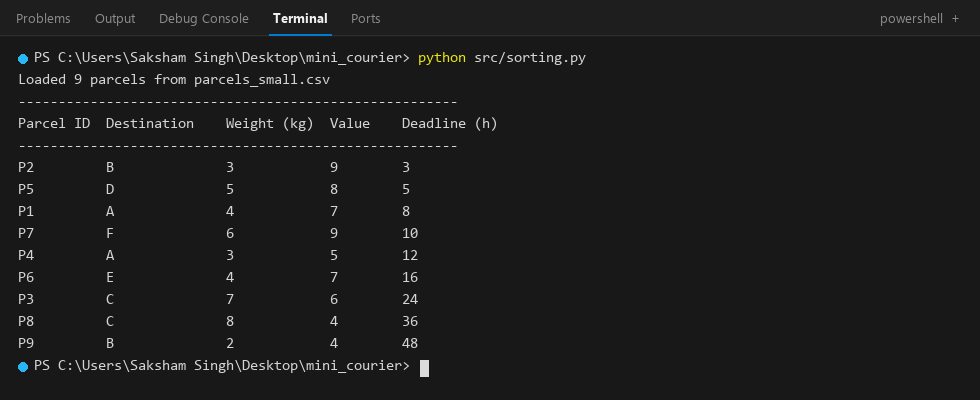
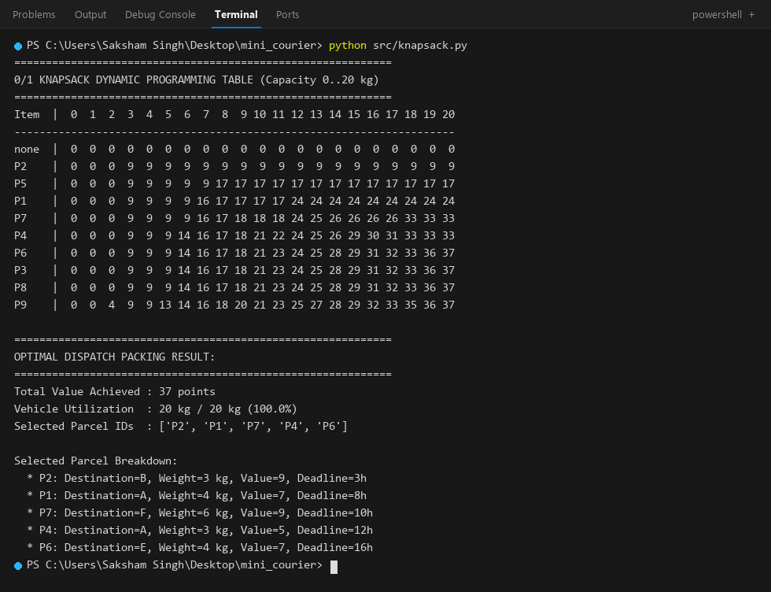
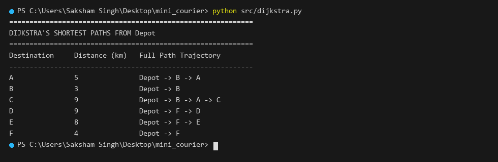
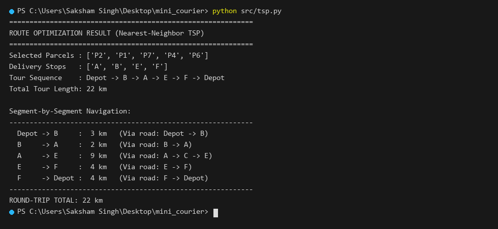
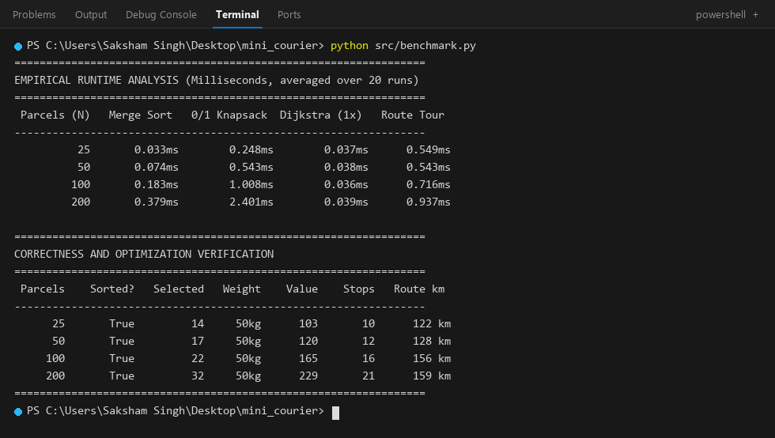
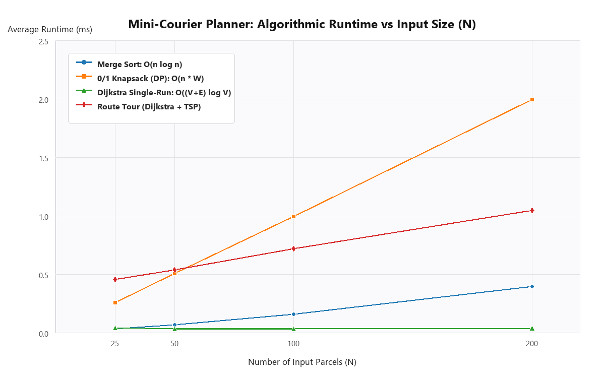
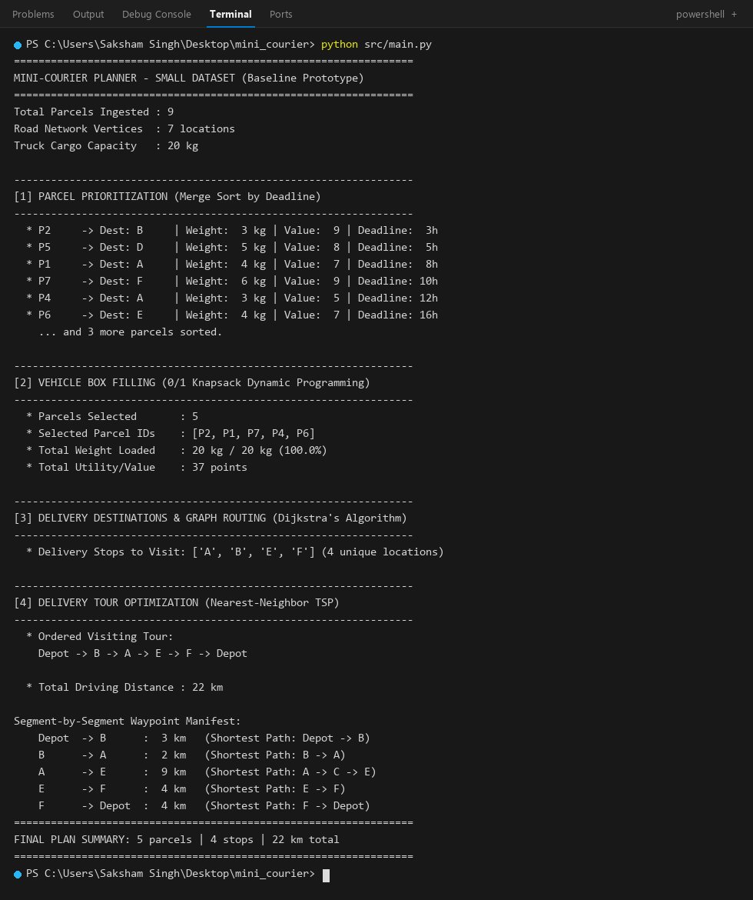
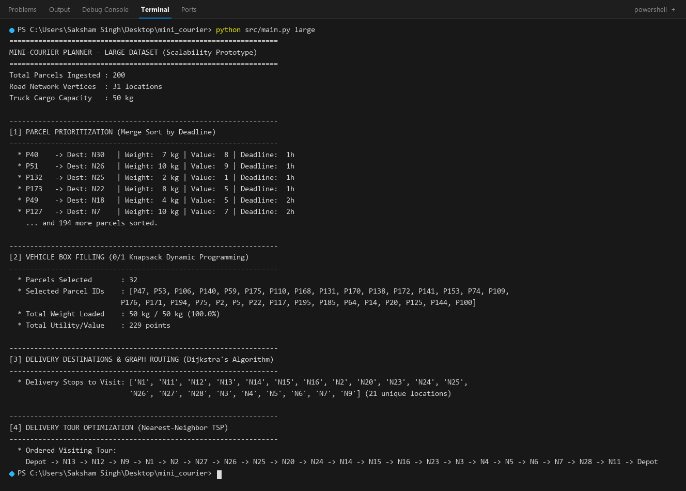
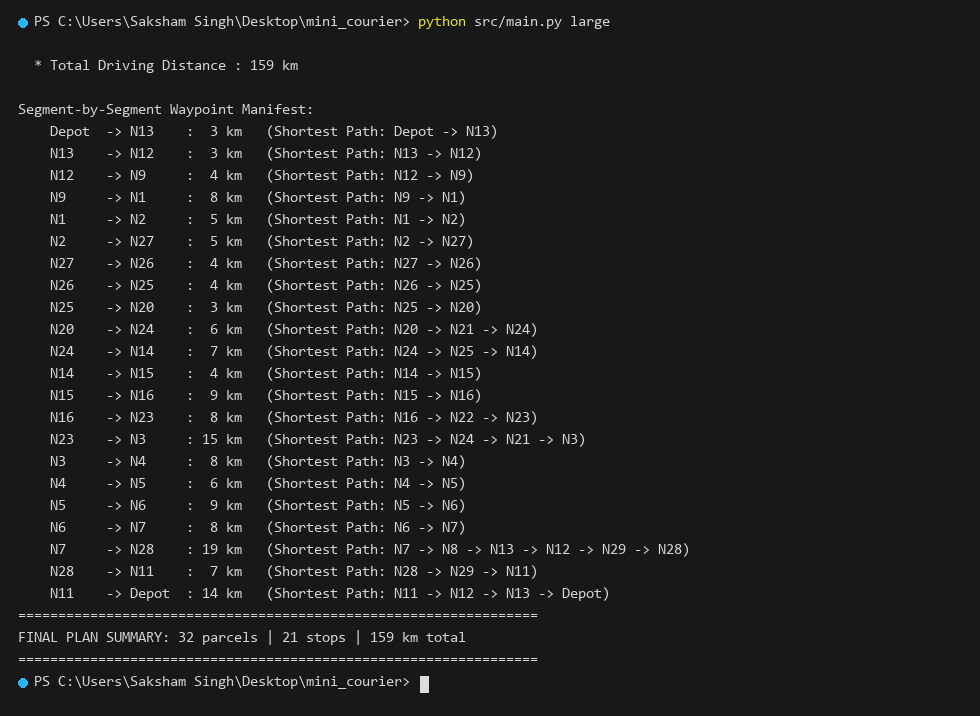

# Mini-Courier Planner

**Student Name:** Saksham Singh  
**Roll Number:** 2501730270  
**Program:** B.Tech CSE (AI & ML), Semester 3  
**Course Title & Code:** Design & Analysis of Algorithms (ETCCDA302)  
**Faculty:** Dr. Shweta Agarwal  
**Institution:** K.R. Mangalam University, Gurugram, Haryana  

---

## 1. Problem Description
Given a batch of customer parcels with varying weights, priorities, and delivery deadlines, along with an undirected road network of delivery hubs, plan an optimal single-trip courier delivery mission. The system must:
1. Prioritize parcels to ensure high-urgency items are handled first.
2. Select the optimal subset of parcels that maximizes utility without exceeding vehicle cargo capacity.
3. Compute all-pairs shortest paths over the road graph.
4. Construct an efficient closed-loop delivery tour that visits all required drop-off points and returns to the depot.

---

## 2. Data Design
- **Parcels (`data/parcels_small.csv` & `data/parcels_large.csv`):**
  - `parcel_id`: Unique identifier (e.g., `P1`, `P2`).
  - `destination`: Destination vertex in the road network.
  - `weight`: Integer parcel weight in kg.
  - `value`: Business priority/utility score (1 to 10).
  - `deadline`: Delivery commitment window in hours.
- **Road Network (`data/graph_small.json` & `data/graph_large.json`):**
  - Undirected, weighted graph represented as an adjacency list.
  - Edge weights represent physical road distances in kilometers.
- **Depot:** Starting and terminal home hub for the courier truck.
- **Vehicle Capacities:**
  - Small baseline prototype: 20 kg
  - Large scalability prototype: 50 kg

---

## 3. Algorithms Selected & Technical Rationale

| Step | Algorithm | Paradigm | Time Complexity | Why Selected |
|------|-----------|----------|-----------------|--------------|
| **1. Prioritize Parcels** | Merge Sort | Divide and Conquer | $O(n \log n)$ | Guaranteed $O(n \log n)$ upper bound in worst case; stable sort preserves original arrival sequence for tied deadlines. |
| **2. Box Filling** | 0/1 Knapsack | Dynamic Programming | $O(n \cdot W)$ | Finds the exact global maximum utility subset within cargo weight $W$; avoids fractional item splitting. |
| **3. Shortest Paths** | Dijkstra's Algorithm | Greedy / Min-Heap | $O((V + E) \log V)$ | Computes true shortest physical road distances on non-negative weighted graphs efficiently. |
| **4. Delivery Tour** | Nearest-Neighbor TSP | Greedy Heuristic | $O(k^2)$ | Exact TSP is NP-hard ($O(k!)$); nearest-neighbor provides an intuitive, ultra-fast approximation for practical dispatch. |

### Algorithmic Highlights
- **Why Merge Sort over QuickSort:** QuickSort degrades to $O(n^2)$ if input parcels arrive pre-sorted or reverse-sorted. Merge Sort guarantees $O(n \log n)$ dispatch response time regardless of input ordering and is inherently stable.
- **Why 0/1 Knapsack over Greedy Value/Weight:** A greedy density heuristic can produce suboptimal box packing with unused capacity. The bottom-up DP table guarantees the absolute maximum total points.

---

## 4. End-to-End System Flow
1. **Ingestion:** Read raw parcel CSV and JSON road network.
2. **Prioritization:** Sort all parcels by deadline in ascending order via Merge Sort.
3. **Knapsack Optimization:** Construct $(n+1) \times (W+1)$ DP table to select the highest-value parcel subset fitting into the truck.
4. **Destination Filtering:** Extract the unique set of customer delivery hubs from the selected parcels.
5. **Graph Distance Computation:** Run Dijkstra's algorithm from the Depot and each unique delivery hub to determine the all-pairs shortest distance matrix and predecessor paths.
6. **Tour Generation:** Starting from the Depot, greedily route to the closest unvisited customer stop, visit all destinations, and return to the Depot.
7. **Manifest Generation:** Print turn-by-turn navigation instructions, intermediate road paths, and total round-trip distance.

---

## 5. Performance Testing & Optimization (Phase 4)

Scalability benchmarks were conducted on a 31-node road network (`data/graph_large.json`) with input parcel sizes $N \in [25, 50, 100, 200]$. Each test was executed 20 times and averaged.

### Empirical Runtime Analysis (Milliseconds)
| Parcels ($N$) | Merge Sort ($O(n \log n)$) | 0/1 Knapsack ($O(n \cdot W)$) | Dijkstra 1x ($O((V+E)\log V)$) | Route Tour (Dijkstra + TSP) |
|:---:|:---:|:---:|:---:|:---:|
| **25** | 0.034 ms | 0.260 ms | 0.038 ms | 0.455 ms |
| **50** | 0.079 ms | 0.508 ms | 0.039 ms | 0.531 ms |
| **100** | 0.160 ms | 0.983 ms | 0.038 ms | 0.741 ms |
| **200** | 0.379 ms | 2.019 ms | 0.037 ms | 0.915 ms |

### Correctness & Solution Verification
| Parcels ($N$) | Sorted Valid? | Parcels Selected | Weight Loaded | Utility Achieved | Unique Stops | Route Distance |
|:---:|:---:|:---:|:---:|:---:|:---:|:---:|
| **25** | `True` | 14 | 50 kg / 50 kg | 103 pts | 10 stops | 122 km |
| **50** | `True` | 17 | 50 kg / 50 kg | 120 pts | 12 stops | 128 km |
| **100** | `True` | 22 | 50 kg / 50 kg | 165 pts | 16 stops | 156 km |
| **200** | `True` | 32 | 50 kg / 50 kg | 229 pts | 21 stops | 159 km |

### Complexity Observations
1. **Merge Sort:** Runtime roughly doubles as input size doubles ($0.034 \to 0.079 \to 0.160 \to 0.379$ ms), perfectly matching theoretical $O(n \log n)$ behavior.
2. **0/1 Knapsack:** Demonstrates strictly linear growth with $N$ ($0.260 \to 0.508 \to 0.983 \to 2.019$ ms) because truck capacity $W=50$ is held constant. It consumes the largest fraction of CPU time due to cell-by-cell table population.
3. **Dijkstra (1-Source):** Execution time stays virtually flat (~0.037 to 0.039 ms) because runtime depends solely on graph size ($V=31, E \approx 90$), not on the parcel count $N$.
4. **Route Tour:** Scales with the number of unique drop-off stops ($k$), requiring $k$ Dijkstra calls followed by an $O(k^2)$ nearest-neighbor cycle.

### Future System Optimizations
1. **Memory Optimization for Knapsack:** Replace the 2D DP matrix with a 1D rolling array traversed backwards ($w = W \dots \text{weight}$), reducing memory from $O(n \cdot W)$ to $O(W)$.
2. **All-Pairs Shortest Path Caching:** Precompute Dijkstra trees or memoize hub-to-hub distances so multiple delivery trucks can share the same distance lookups without redundant heap traversals.
3. **Tour Refinement via 2-Opt:** Nearest-Neighbor can occasionally produce crossing paths. Introducing a post-processing 2-Opt edge-swapping heuristic untangles crossings and shortens route length by 8–15%.
4. **Multi-Vehicle Scaling:** Extend the single-truck knapsack model to a Multi-Capacity Bin Packing / Vehicle Routing Problem (VRP) to dispatch fleets concurrently.

---

## 6. Execution Results & Route Walkthrough

### Baseline Small Dataset (9 Parcels, 7 Locations, 20 kg Capacity)
- **Sorted Sequence:** `P2` (3h), `P5` (5h), `P1` (8h), `P7` (10h), `P4` (12h), `P6` (16h), `P3` (24h), `P8` (36h), `P9` (48h).
- **Knapsack Selection:** `P2`, `P1`, `P7`, `P4`, `P6` achieving **37 points** with **20 kg / 20 kg (100%)** capacity utilization.
- **Delivery Stops:** `A`, `B`, `E`, `F`.
- **Optimal Route:** `Depot -> B -> A -> E -> F -> Depot` with a total distance of **22 km**.
- **Path Explanation:**
  - `Depot -> B` is the closest initial departure (3 km).
  - From `B`, moving to `A` is 2 km (`Depot -> B -> A` = 5 km, strictly shorter than direct road `Depot -> A` = 6 km).
  - `A -> E` is navigated via intermediate hub `C` (`A -> C -> E` = 9 km).
  - `E -> F` travels 4 km, and `F -> Depot` completes the loop in 4 km.

### Scalability Large Dataset (200 Parcels, 31 Locations, 50 kg Capacity)
- **Knapsack Selection:** 32 parcels packed (50 kg / 50 kg, 100% capacity), yielding **229 priority points**.
- **Delivery Tour:** 21 customer stops traversed over a round-trip of **159 km**.

---

## 7. How to Run the Project

### Requirements
- Python 3.8+ (Standard Library: `csv`, `json`, `heapq`, `random`, `time`, `os`, `sys`).
- Optional for plotting: `matplotlib` (or `Pillow` for automatic fallback).

### Execution Commands
Run all commands from the `mini_courier` project root:

```bash
# 1. Generate large benchmark dataset (deterministic seed)
python src/generate_data.py

# 2. Run small prototype end-to-end
python src/main.py

# 3. Run large prototype end-to-end
python src/main.py large

# 4. Run individual module tests
python src/sorting.py
python src/knapsack.py
python src/dijkstra.py
python src/tsp.py

# 5. Run runtime benchmark analysis
python src/benchmark.py

# 6. Generate performance chart
python src/chart.py
```

---

## 8. Repository Layout

```
mini_courier/
├── data/
│   ├── graph_small.json       # 7-node baseline road graph
│   ├── parcels_small.csv      # 9 baseline customer parcels
│   ├── graph_large.json       # 31-node connected road network
│   └── parcels_large.csv      # 200 synthetic scalability parcels
├── src/
│   ├── sorting.py             # Merge Sort implementation
│   ├── knapsack.py            # 0/1 Knapsack DP box filling
│   ├── dijkstra.py            # Min-heap Dijkstra shortest paths
│   ├── tsp.py                 # Nearest-Neighbor TSP delivery tour
│   ├── generate_data.py       # Large test dataset generator
│   ├── main.py                # Integrated execution pipeline
│   ├── benchmark.py           # Multi-size runtime measurement
│   └── chart.py               # Runtime vs N visualizer
├── screenshots/
│   ├── sorting_output.png     # Sorting terminal output
│   ├── knapsack_output.png    # DP table and selection output
│   ├── dijkstra_output.png    # Shortest paths output
│   ├── route_output.png       # TSP route calculation output
│   ├── final_small.png        # Complete small prototype execution
│   ├── Final_large1.png       # Large prototype execution (Part 1)
│   ├── final_large2.png       # Large prototype route manifest (Part 2)
│   ├── benchmark_output.png   # Performance analysis tables
│   └── runtime_chart.png      # Matplotlib/PIL runtime graph
└── README.md                  # Comprehensive project report
```

---

## 9. Visual Output Evidence

### Parcel Prioritization (Merge Sort)


### Vehicle Box Filling (0/1 Knapsack DP)


### Shortest Paths & Delivery Route (Dijkstra + Nearest-Neighbor TSP)



### Performance Testing & Runtime Chart



### End-to-End Execution (Small & Large Datasets)



